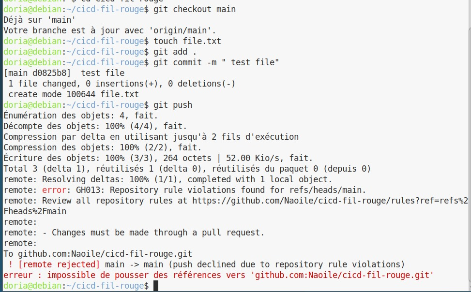
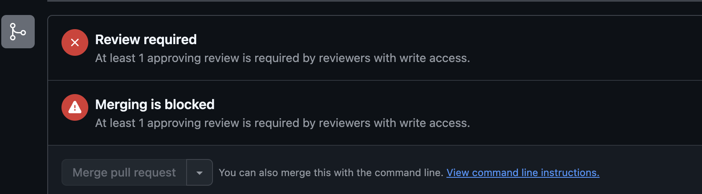
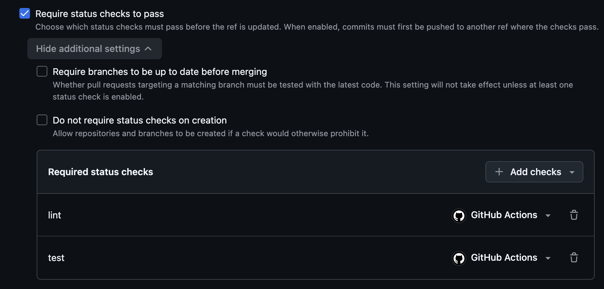
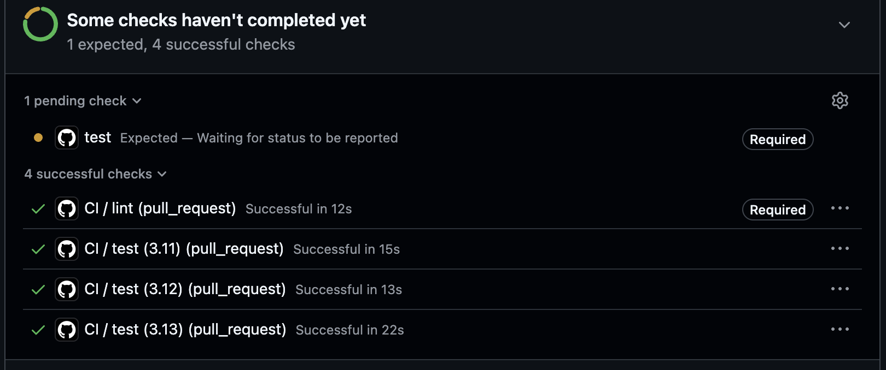

# TaskFlow — dépôt fil rouge CI/CD

TaskFlow est une petite API de gestion de tâches écrite en Python avec FastAPI.
C'est le projet fil rouge du module CI/CD (Mastère DevOps M1, Sup de Vinci) :
pendant trois jours, vous allez construire autour d'elle un pipeline complet
qui teste, construit, sécurise et livre l'application.

## Lancer l'API en local

Prérequis : Python 3.10 ou plus récent.

```bash
python3 -m venv .venv
source .venv/bin/activate          # Windows : .venv\Scripts\activate
pip install -r requirements-dev.txt
uvicorn app.main:app --reload
```

L'API répond sur http://localhost:8000 et sa documentation interactive est sur
http://localhost:8000/docs.

## Vérifier le code

```bash
pytest           # tests automatiques
ruff check .     # lint
ruff format .    # mise en forme
```

## Lancer avec Docker

```bash
docker build -t taskflow .
docker run --rm -p 8000:8000 taskflow
```

## Endpoints

| Méthode | Chemin | Rôle |
| --- | --- | --- |
| GET | `/health` | État de l'API et version |
| GET | `/tasks` | Liste des tâches |
| GET | `/tasks/search?q=...` | Recherche dans les titres |
| POST | `/tasks` | Crée une tâche (`{"title": "..."}`) |
| GET | `/tasks/{id}` | Détail d'une tâche |
| PATCH | `/tasks/{id}/done` | Marque une tâche comme faite |
| DELETE | `/tasks/{id}` | Supprime une tâche (en-tête `X-API-Token` requis) |

## Configuration

| Variable | Rôle | Défaut |
| --- | --- | --- |
| `APP_VERSION` | Version affichée par `/health` | `0.1.0` |
| `DB_PATH` | Fichier SQLite | `taskflow.db` |
| `API_TOKEN` | Jeton exigé pour supprimer une tâche | vide (suppression désactivée) |
| `NOTIFY_WEBHOOK_URL` | Webhook appelé à chaque création de tâche | vide (désactivé) |

## Équipe

<!-- Lab J1 : remplacez par les noms du binôme -->
Par Naoile et Doria

## Gouvernance du dépôt

<!-- Lab J1 : listez les règles activées sur main, pourquoi chacune, et ajoutez la capture du push refusé -->

## Protégez le dépôt git:

Parmis les règles imposer dans ce GIT nous avons une PR avant merge, l'approbation du binôme ainsi que le refus d'un push forcer ou d'une suppression.

Parmis les capture d'exemple d'imposition des regles, vous retrouverez : le push refusé et une pr sous appobation :


  PUSH REFUSÉ

Vérification d'un push non autorisé grâce au rulesets qui bloque les push forcée.


PR sous approbation
   
   Une approbation est necessaire avant le merge

## Aucun code dans main sasn lint ni tests : Pipeline CI

Status check obligatoire
   
  Avec cette nouvelle regles pour fusionner une PR dans main il faudra également un job lint et test réussi en plus de l'approbation du binôme

   ## SECTION :
   1) PR bloqué malgré des tests réussis
   
   Après l'ajout d'un matrice Python, les checks sont vert mais le la pr est rester bloquée car le ruleset demande toujours la verification de la rulset "test".

   Le job lint vérifie que notre code respecte les règles de programmation sans l'éxcuter.

   Le job test lui va exécuter des tests pour vérifier que notre code se comporte comme prévue.

   Comparaison avec et sans cache : 

   Sans cache : 8 secondes

   Avec cache : 6 secondes

   Le cache pip a permis de réduire le temps d'installation de 2 secondes.

   Rôle du job CI OK : 

   Le job CI OK vérifie que les jobs lint et test se sont terminer avec succès, il est le seul check onligatoire dasn le rulestet, ce qui empeche la fusion d'une PR si un contôle échoue.


